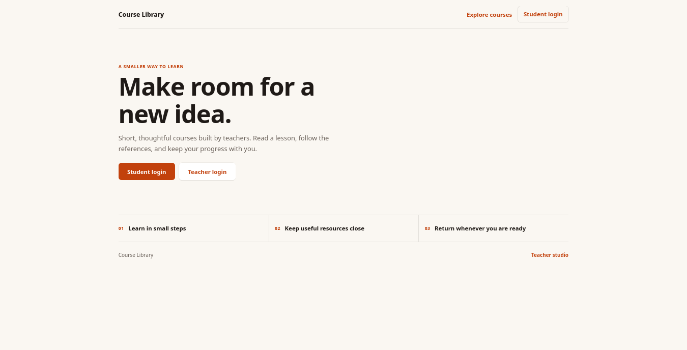
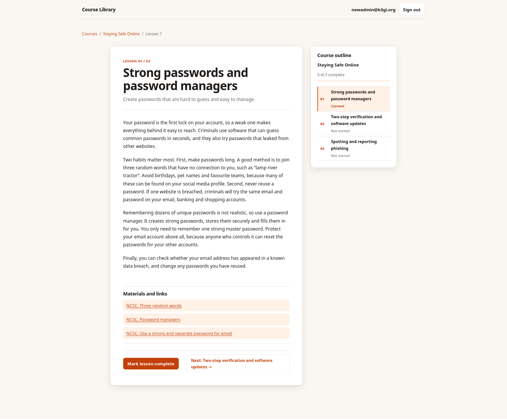
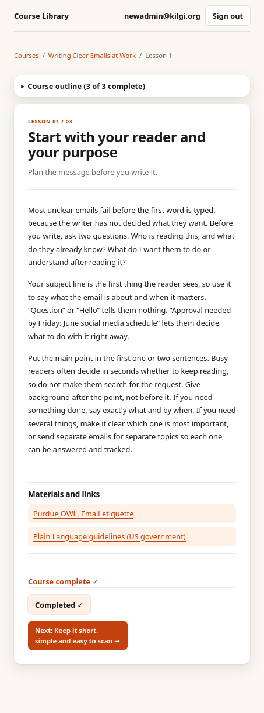
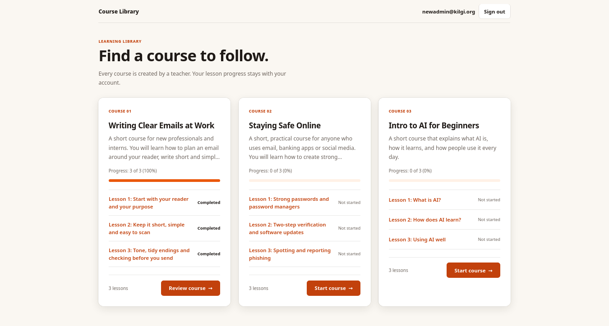

# Mini Learning Course

A Supabase-backed course app with student and teacher modes. Teachers create courses in the teacher studio; students read course and lesson content and save lesson completion to their accounts.

**Live app:** [https://kilgi.github.io/mini-learning-course](https://kilgi.github.io/mini-learning-course)

## Screenshots









## Features

- Students can create an account, sign in, browse courses, and open lessons.
- Courses and their ordered lesson content are stored in Supabase PostgreSQL as JSONB.
- Lesson completion is stored per signed-in user, course, and lesson.
- Teachers can create and edit courses, lesson text, external links, and uploaded PDF or Word resources.
- Uploaded resources are stored in a private Supabase Storage bucket and served with signed URLs.

## Technology

- HTML, CSS, and browser JavaScript; no build step or frontend framework.
- Supabase Auth, PostgreSQL, Row Level Security (RLS), and Storage.
- GitHub Pages for the static site.

## Setup

### Configure Supabase

1. Create a project in the [Supabase dashboard](https://supabase.com/dashboard) and enable Email under **Authentication > Providers**.
2. Copy the project URL and public publishable key (or legacy anon key) from the project's API settings. Set `SUPABASE_URL` and `SUPABASE_ANON_KEY` in `js/supabase-config.js`. These values are used by browser code; never put a service-role or secret key there.
3. In the Supabase SQL Editor, run every SQL block in `docs/supabase-setup.md` in the order shown. This creates the `lesson_progress`, `course_feedback`, and `course_content` tables and their initial policies. Run the SQL only, not the surrounding Markdown.
4. After all three tables exist, run `docs/security-fix.sql` in the SQL Editor. It applies the final RLS policies and constraints and configures the private `course-materials` bucket.
5. Create a teacher's Supabase Auth account in **Authentication > Users**. Using trusted dashboard tooling or a server-side Auth Admin API, set its `app_metadata` role to `admin`:

   ```json
   { "role": "admin" }
   ```

   Do not set this role from browser code or user-editable metadata. After changing the role, sign out and back in so the account receives the updated claim. Students can create accounts from the student sign-in page; only accounts with the trusted role can use teacher mode.
6. In **Authentication > URL Configuration**, set the **Site URL** to `https://kilgi.github.io/mini-learning-course/` for the deployed site. Add the deployed callback pattern and the local URLs you use to **Redirect URLs**:

   ```text
   https://kilgi.github.io/mini-learning-course/**
   http://localhost:8000/**
   http://127.0.0.1:8000/**
   ```

   Use HTTPS for the deployed site. Set the Site URL to the appropriate environment when testing locally if your Auth flow requires it.

### Run locally

From the project root, start a static server:

```sh
python3 -m http.server 8000
```

Open `http://localhost:8000/`. Configure the Supabase project and Auth URLs before signing in. The public page links to student login and teacher login.

## Project structure

```text
.
├── index.html
├── login.html
├── student.html
├── teacher.html
├── css/
│   └── style.css
├── docs/
│   ├── complete.png
│   ├── lesson.png
│   ├── mobile.png
│   ├── overview.png
│   ├── security-fix.sql
│   └── supabase-setup.md
├── js/
│   ├── auth.js
│   ├── login.js
│   ├── student.js
│   ├── supabase-config.js
│   └── teacher.js
├── DESIGN.md
├── README.md
└── TESTING.md
```

## Security

The browser uses only the public publishable/anon key. Anonymous access is revoked from the application tables, and RLS policies control authenticated access. Authenticated users can read course content and course materials. Students can read and insert their own progress; trusted admins can read or delete progress. Users can read, insert, and update their own feedback; trusted admins can delete feedback. A trusted `app_metadata.role = 'admin'` claim allows course-content writes and Storage uploads/deletions. The current policies do not assign courses to individual teachers: any account with that trusted role can update any course row. The teacher-page role check controls the UI, but RLS is the database authorization boundary. Never commit service-role keys, passwords, or private account information. See [docs/supabase-setup.md](docs/supabase-setup.md) and [docs/security-fix.sql](docs/security-fix.sql).

## More information

- [System design](DESIGN.md)
- [Manual testing checklist](TESTING.md)